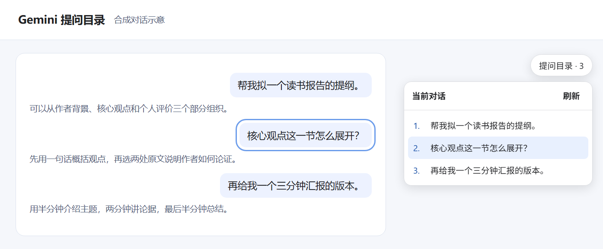

# Gemini 对话侧边快速索引

在 Gemini 网页版的右侧放一个可折叠的提问目录。长对话里想回看某一轮时，点目录里的提问就能跳回原消息。

**[从 Greasy Fork 安装](https://greasyfork.org/zh-CN/scripts/606844)** · [从 GitHub 直接安装](https://raw.githubusercontent.com/gdutno1/gemini-question-index/main/gemini-question-index.user.js) · [English](#english) · [反馈问题](https://github.com/gdutno1/gemini-question-index/issues)

*界面示意图使用合成对话内容，目录由脚本实际渲染。*

## 使用方法

- 右侧「提问目录」显示当前对话已加载的提问数量，点标题可展开或收起。
- 条目按提问顺序排列。点任一条，页面会滚动到原提问并短暂高亮。鼠标悬停在条目上可看完整提问。
- 发送新提问、修改提问或切换对话后，目录会随页面更新。长对话里可以先向上滚动，让 Gemini 加载更早的消息，必要时点「刷新」重新读取目录。

## 安装

1. 在 Edge 或 Chrome 中安装 [Tampermonkey（篡改猴）](https://www.tampermonkey.net/)。
2. 在浏览器的扩展管理页打开篡改猴的详情，开启「允许用户脚本」。这个选项的位置因浏览器版本而异，可查看 [Tampermonkey 权限说明](https://www.tampermonkey.net/faq.php?locale=zh_CN&q=Q209)。
3. 在 Greasy Fork 页面点击「安装此脚本」，或使用上方的 GitHub 直装链接，在篡改猴显示的安装页确认安装。
4. 打开或刷新 [Gemini](https://gemini.google.com/)，进入任意对话，在右侧查看目录。

如果浏览器直接显示源代码，可以在篡改猴管理面板新建脚本，粘贴完整的 [脚本源码](https://raw.githubusercontent.com/gdutno1/gemini-question-index/main/gemini-question-index.user.js) 并保存。

## 工作范围

脚本只在 `gemini.google.com` 运行，直接读取当前网页里已加载的提问。脚本不会上传、保存或同步聊天内容，也没有外部代码依赖。已在 Windows Edge 和 Tampermonkey 上验证，Gemini 更新网页结构后可能需要适配。

项目由 [@gdutno1](https://github.com/gdutno1) 发布和维护。初版用 Gemini 辅助编写，后续由 Codex 协助修改和测试。欢迎安装使用并分享安装链接。

## English

Gemini Question Index adds a collapsible list of your prompts to the right side of the Gemini web app. Select a prompt to scroll to the original message and briefly highlight it. The list updates when the current chat changes and only includes messages Gemini has loaded. The panel labels are in Simplified Chinese.

1. Install [Tampermonkey](https://www.tampermonkey.net/) for Edge or Chrome.
2. Enable **Allow User Scripts** in the browser's extension settings for Tampermonkey. See [Tampermonkey's permission guide](https://www.tampermonkey.net/faq.php?q=Q209).
3. Install from the [Greasy Fork listing](https://greasyfork.org/en/scripts/606844) or [directly from GitHub](https://raw.githubusercontent.com/gdutno1/gemini-question-index/main/gemini-question-index.user.js), then confirm in Tampermonkey.
4. Open or reload a [Gemini](https://gemini.google.com/) chat. Click **提问目录** to open or collapse the prompt list, and **刷新** to refresh it manually.

The script reads prompts already loaded in the current Gemini tab. It has no external dependencies and does not upload, store, or sync your chat content. Verified on Windows with Microsoft Edge and Tampermonkey.

Published and maintained by [@gdutno1](https://github.com/gdutno1). AI assistance was used to write, revise, and test the script.
